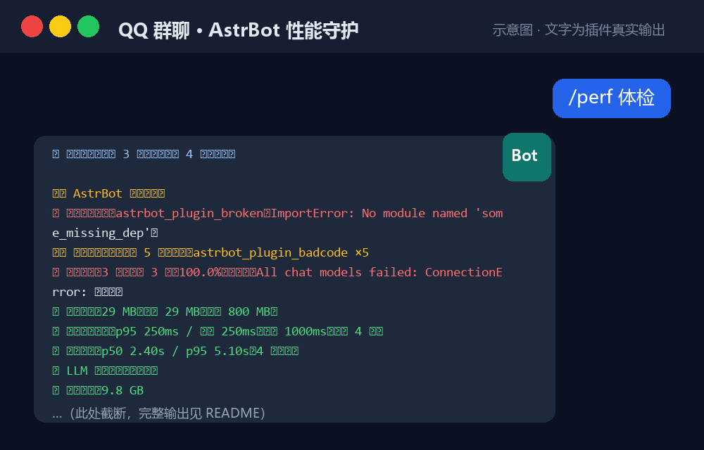

<p align="center">
  
</p>

# astrbot_plugin_perf_guard · AstrBot 性能守护

> 专治 AstrBot「回复太慢」：**先告诉你慢在哪**，再自动做内存/日志/重启的日常保养。
> 外加一半价值在「**不回话**」这一类：插件报错点名、模型失败监测、一键体检。

## 它不会拖慢系统（实测开销）

一个"性能优化插件"如果自己就吃 CPU，那是负优化。所以这里给实测数据（`_perf_guard_bench.py`）：

| 项目 | 数值 |
| --- | --- |
| 栈采样线程 CPU（默认每 200ms 采一次） | **约 0.004%** 单核 ≈ **0.14 秒 CPU / 小时** |
| 每条消息的全部埋点（4 个钩子） | **约 5~13 微秒**（LLM 一次回复通常 1000ms 级别，占比约 0.001%） |
| 事件循环延迟影响 | 无（A/B 交替测试中定时器 p50 完全相同） |
| 状态落盘 | 去抖：20 秒内最多写一次盘（500 次调用只写 1 次） |
| 日志目录扫描 | 只扫一层 + 通配符 + 上限，比全递归快约 10 倍 |

设计上刻意遵守的几条规则：

- **不在热路径上碰磁盘**：消息钩子只做内存操作；日志清理、状态查询都丢到线程里
- **卡顿瞬间不加重卡顿**：写盘与日志都去抖（卡顿时最忌讳再写磁盘、再格式化日志）
- **采样只抓轻量元组**，只有真的卡了才把栈格式化成文本
- **可以彻底关掉**：`stack_sampling_enabled=false`（只少了"定位到具体插件"的能力）

`/perf 状态` 里会显示 **本插件自身开销** 一行，你可以随时自己核对，不用信我。

## 它解决什么问题

AstrBot 回复慢，通常只有三个原因，本插件把三者都能测出来：

| 慢的类型 | 表现 | 插件怎么帮你 |
| --- | --- | --- |
| **某个插件把事件循环卡住** | 偶发卡顿、多个群同时不回复 | 监测事件循环延迟，卡顿时抓取主线程调用栈，**直接指出是哪个插件的哪一行代码在阻塞** |
| **LLM 接口本身慢** | 每条都慢，等几秒到几十秒 | 统计消息响应耗时与 LLM 耗时占比，给出换模型/开流式/缩历史等建议 |
| **长时间运行累积的臃肿** | 重启后变快，跑几天又慢 | 自动释放内存、清理日志、内存超阈值或定时自动重启 |

但它还有一半价值在"**不回话**"这一类问题上——那通常跟性能无关：

| 故障类型 | 表现 | 插件怎么帮你 |
| --- | --- | --- |
| **别的插件报错** | 机器人偶尔不回话、某个功能时灵时不灵、日志里一堆红字 | 接住其它插件抛出的异常，**点名是哪个插件的哪个处理函数**，连续报错还会主动私聊通知你（`/perf 报错`） |
| **模型/中转挂了** | 所有人都不回话，但你以为是卡了 | 识别模型失败响应（`role=err`），显示失败率与最近原因，连续失败主动通知（`/perf 状态`） |
| **插件压根没加载成功** | 插件列表里看着有，功能完全不存在 | 体检时直接列出**加载失败的插件名与原因**（`/perf 体检`） |
| **磁盘/数据写满** | 突然无法保存会话、日志写不进去 | 磁盘余量低于警戒线时告警 + 自动清日志，并显示数据库体积（`/perf 数据库`） |

以上四类都汇总在一条命令里：**`/perf 体检`**。

## 安装

1. 把 `astrbot_plugin_perf_guard` 整个文件夹放到 AstrBot 的 `data/plugins/` 下
2. 在 WebUI「插件管理」里重载插件（或重启 AstrBot）
3. **无需安装任何依赖**（`psutil` 本来就在 AstrBot 的依赖里；即使没有，插件也会自动退化为系统接口读取内存）

## 快速开始

```
/perf            # 看一眼当前状态
/perf 体检        # 🩺 一键健康检查：哪里不对、下一步做什么
/perf 诊断        # ⭐ 回复速度诊断：慢在哪 + 加速建议
/perf 报错        # 哪个插件在报错（按插件排行）
/perf 释放内存    # 立刻做垃圾回收（工作集裁剪默认关闭，见配置说明）
/perf 清理日志    # 按保留天数/总大小上限清理日志
```

> 以上指令默认**仅管理员**可用（`command_admin_only`）。

## 🩺 `/perf 体检`：一键健康检查

<p align="center">
  
</p>

> 上图为示意图：**回复文字是插件真实输出**（由自测环境实际调用生成），聊天界面本身是画的。

它会把散落在各处的判断汇成一份带结论的清单，**每项都告诉你"要不要担心"**，最后给出按优先级排好的待办：

```
🩺 体检结果：发现 1 个问题，另有 2 项需要留意

✅ AstrBot 版本：4.27.4
❌ 插件加载失败：astrbot_plugin_foo（ImportError: No module named 'bar'）
✅ 已加载插件：12 个，无加载失败记录
⚠️ 插件运行报错：累计 7 次；最多：astrbot_plugin_baz ×5
⚠️ 模型调用：23 次中失败 3 次（13.0%）；最近：All chat models failed: ConnectionError
✅ 进程内存：312 MB（峰值 480 MB，阈值 800 MB）
✅ 事件循环卡顿：p95 18ms / 最大 240ms（阈值 1000ms，采样 640 次）
✅ 消息响应：p50 1.82s / p95 5.10s（37 条样本）
✅ LLM 工具：本次请求携带 6 个，无重名
✅ 磁盘剩余：42.7 GB
✅ 日志占用：9 个文件 / 18.3 MB
✅ 数据库体积：共 21.4 MB（data_v4.db 21.4MB），可回收约 3.1 MB
✅ 可用重启方式：Dashboard 接口、看门狗
✅ 自动重启：已关闭（不会自己重启机器人）
✅ psutil（读内存/CPU）：已安装
✅ 指令权限：指令/LLM 工具仅管理员可用 | admins_id：123456789

💡 建议按这个顺序处理：
1. 有插件加载失败 → WebUI 插件页看报错原因，改好或用插件页的"重载"
2. 看 `/perf 报错` 定位是哪个插件在报错（报错插件常连带拖慢整条消息）
3. 数据库有较多空闲页 → `/perf 数据库 整理 yes` 可回收（会短暂锁库，建议闲时做）
```

它检查 14 项，其中这几项是别处看不到的：

- **插件加载失败**：从 `StarManager.failed_plugin_dict` 读取。加载失败的插件是典型"静默故障"——插件列表里看着像存在，实际功能全无。
- **插件运行报错**：需要 AstrBot 有 `on_plugin_error` 钩子（4.x 有）。报错最多的插件最值得先看。
- **模型可用性**：识别 `role=err` 的失败响应。"机器人突然不回话"十有八九是 API 中转/密钥/额度问题，不是卡顿。
- **权限自检**：直接列出 AstrBot 主配置的 `admins_id` 名单——QQ **私聊**里没有群角色，只认这份名单，而它的默认值是占位符 `["astrbot"]`。

## 🧯 `/perf 报错`：哪个插件在报错

```
🧯 插件报错统计（本进程累计 9 次，最近 2 类）

按插件排行：
· astrbot_plugin_baz ×7
· astrbot_plugin_qux ×2

最近几类错误（同类已合并计数）：
· [03-14 21:07:33] astrbot_plugin_baz / on_message（×5）
    ValueError: invalid literal for int() with base 10: ''
```

说明与取舍：

- 同类错误（同插件 + 同异常文本）会**合并计数**，不会因为一个循环刷出几百条。
- 报错时会立刻在 AstrBot 日志里写一行 `⚠️ 检测到插件报错：...`，方便你事后翻日志。
- 连续报错（默认窗口 10 分钟内 ≥3 次）会**主动通知管理员**，通知有 30 分钟冷却，不会刷屏。
- 本插件**不会**调用 `event.stop_event()` 去屏蔽 AstrBot 默认的报错回显——那是别的插件的错误，应该让你看见，而不是被运维插件偷偷吞掉。

## 回复速度诊断怎么看

`/perf 诊断` 输出分四块：

```
🩺 AstrBot 回复速度诊断

📨 消息响应耗时（最近 12 条）
· 中位数 p50：2.31s
· 长尾 p95：8.40s
· 最慢：11.20s
· 其中 LLM 调用：p50 1.90s / p95 7.80s
· LLM 占响应总耗时约 82%

⚡ 事件循环卡顿（240 次采样，阈值 1000ms）
· 延迟 p50 12ms / p95 1340ms / 最大 3120ms
· 超过阈值：3 次
· 卡顿嫌疑：astrbot_plugin_xxx ×3

🖥 资源占用
· 内存：312 MB（峰值 420 MB）
· CPU：12%
· 本插件自身开销：采样线程累计 CPU 12.3ms / 运行 3 天 2 小时（约 0.004%，折合每小时 0.1 秒 CPU），每 200ms 采一次，共 1348204 次
· 上下文裁剪：上次请求 48 条 → 30 条（累计裁掉 1204 条）
· 官方卡顿日志：C:\AstrBot\data\logs\event_loop_watchdog.log（最后更新 10-07 03:12）
· LLM 工具数：12 个（无重名）

🔍 最近一次卡顿现场（3120ms，嫌疑：astrbot_plugin_xxx）栈尾 4 行：
   File ".../data/plugins/astrbot_plugin_xxx/main.py", line 88, in handler
   resp = requests.post(url, timeout=30)

💡 加速建议
...
```

**怎么解读：**

- `LLM 占响应总耗时` **高（>70%）** → 瓶颈在模型/网络，往下看「加速清单」第 1~3 条
- `事件循环卡顿` 有超标 + 有嫌疑插件 → 就是那个插件在协程里做同步阻塞，**它是罪魁祸首**，停用或催作者改异步
- 两个都不高但内存很大 → 用 `/perf 释放内存`，并开启自动释放/自动重启

## 让机器人变快的实操清单（按收益排序）

1. **换更快的模型或服务商**：这是最大头。国内直连的中转/官方国内节点，比绕道海外的 API 快几倍。
2. **开启流式输出**：首字延迟立刻改善（在 AstrBot 的模型/服务商配置里开启流式，配置项名以你的版本为准）。
3. **砍上下文**：缩短系统提示词、人设、知识库检索、历史轮数——上下文越长，首字越慢。
4. **关掉用不到的插件**：每个插件都参与消息处理，插件越多每条消息越慢；有阻塞型插件时尤其致命（本插件的诊断会揪出来）。
5. **关掉重功能**：TTS 语音、图文渲染（T2I）、网页截图等，改为按需触发。
6. **日常保养**：开启自动释放内存 + 定时重启（凌晨低峰期），避免跑几天后越来越卡。
7. **服务器别开省电模式**，磁盘别塞满（本插件会清理日志）。

### 本插件提供的一键提速开关

| 配置项 | 作用 | 建议 |
| --- | --- | --- |
| `max_context_messages` | 每次请求只带最近 N 条上下文（**0 = 不裁剪**），直接缩短提示词 → 首字更快 | 先试 **40**，还慢就调到 20 |
| `force_streaming` | 强制每条消息走流式输出，机器人更快"开口" | 回复慢就打开；若发现分段排版异常则关掉 |

> `max_context_messages` 只在 **user 消息边界**裁剪，不会留下"孤儿工具调用"导致报错；
> 代价是实际会略多切一两条。裁剪量会在 `/perf 诊断` 里显示。

### AstrBot 自带的诊断工具（先用这些，再装插件）

不用装任何插件，AstrBot 本身已经有一些能力，配合使用更省事：

- **LLM 首字延迟（TTFT）与平均耗时**：面板的统计页（官方记录 `provider_stats`）
- **官方卡顿看门狗**：内置事件循环诊断，默认 **15 秒**阈值，命中时写
  `data/logs/event_loop_watchdog.log`（本插件的 `/perf 诊断` 会提示这个文件是否存在）
- **官方存储清理**：面板里的「存储清理」可清日志/缓存

本插件的差异：卡顿阈值可调到 1 秒级、能**定位到具体插件**，并提供消息级耗时统计与上下文裁剪。

### 关键配置项速查（AstrBot 自身的）

- `provider_settings.streaming_response`：流式输出开关（默认 false），打开后首字更快
- `log_file_enable`：是否写日志文件（默认 **false**），不打开就没有日志文件可清
- `log_file_max_mb`：日志单文件上限（默认 20MB），超出自动轮转、保留 3 个备份

## 指令与 LLM 工具

| 指令 | 作用 |
| --- | --- |
| `/perf` `/perf 状态` | 内存、运行时长、日志占用、磁盘、累计重启、插件报错、模型健康度、各项自动化开关 |
| `/perf 体检` | 🩺 一键健康检查（14 项 + 按优先级排好的待办） |
| `/perf 诊断` | 回复速度诊断（卡顿 + 耗时 + 阻塞定位 + 建议） |
| `/perf 报错` | 插件报错排行与最近错误明细 🧯 |
| `/perf 数据库` | 数据库体积、页统计、可回收空间；加 `整理 yes` 执行 VACUUM 🗄 |
| `/perf 释放内存` | `gc.collect()`（工作集裁剪默认关闭） |
| `/perf 清理日志` | 立即清理日志 |
| `/perf 重启` | 重启 AstrBot（需看门狗或官方接口） |
| `/perf 最慢 [n]` | 慢消息排行 + 三段耗时拆分（预处理/模型/后处理）🐌 |
| `/perf 报告 [天]` | 性能趋势报告：内存走势图、耗时变化、卡顿与消息统计 📈 |
| `/perf 快照 [n]` | 查看故障现场快照（卡顿/内存告警时自动保存）🗂 |
| `/perf 内存追踪` | 开始/结束按需内存追踪，输出泄漏排行 🔬 |
| `/perf AI` | 让 AI 评估一次当前状态，给出待审核提议 🤖 |
| `/perf 待审` | 查看等待审核的 AI 提议 |
| `/perf 批准 [编号]` | 执行某条待审核提议（只有管理员能用） |
| `/perf 拒绝 [编号]` | 取消某条待审核提议 |
| `/perf AI模型` | 列出可用对话模型（填 `ai_provider_id` 用） |
| `/perf 帮助` | 帮助 |

| LLM 工具 | 作用 | 默认 |
| --- | --- | --- |
| `perf_guard` | 一个工具搞定全部，参数 `action` 取：`status` 查状态 / `health_check` 做体检 / `diagnose` 诊断慢 / `release_memory` 释放内存 / `clean_logs` 清日志 / `restart` 重启 / `ai_review` 让 AI 做一次状态评估 | 仅管理员 |

> 为什么只做一个工具？插件每多注册一个工具，**每次请求的提示词都会变长**，而且和其它插件
> 的工具挤在一起时模型更容易选错。合成一个工具后，本插件对每次请求只增加约 60 token。

`restart` 这个动作默认被禁止（`llm_allow_restart=false`），要让机器人能自己重启再打开它。

## 诊断工具箱（四个实用工具）

### 🐌 `/perf 最慢` —— 慢消息慢在哪一段

把每次回复拆成三段：**预处理（收到→请求模型）/ 模型 / 后处理（模型结束→发出）**，
一眼看出该怪模型还是该怪插件。

```
🐌 慢消息排行（累计记录 6 条，显示最新 3 条）

· 10-07 03:12｜总 18.4s（预处理 0.2s / 模型 17.6s / 后处理 0.6s）
  会话：aiocqhttp:GroupMessage:123｜发送者：10086
· 10-07 02:47｜总 12.1s（预处理 9.8s / 模型 1.9s / 后处理 0.4s）
  ⚠️ 期间事件循环卡顿 2 次，最严重 1204ms，嫌疑：astrbot_plugin_xxx

👉 判读：模型段最长 → 换更快模型 / 缩短上下文；预处理或后处理段最长 → 多半是别的插件在同步阻塞
```

超过多少秒算"慢"由 `slow_message_seconds` 决定（默认 5 秒）。只记录不额外消耗资源。

### 📈 `/perf 报告 [天]` —— 是不是在变慢

每 `history_interval_minutes`（默认 10 分钟）采一个点，**纯内存运算**，数据存 `history.json`。

```
📈 性能趋势报告（最近 3 天）
· 采样点：432 个（每 10 分钟一次）
· 内存：268 MB → 402 MB（峰值 420 MB）
  ▁▂▂▃▃▄▄▅▅▆▆▇▇█▇▆
· CPU：平均 8%（峰值 34%）
· 消息响应 p50：2.80s → 4.10s（中位 3.20s）
· 事件循环卡顿：7 次
· 期间处理消息：1024 条
· 趋势判断：⚠️ 内存相对上涨 38%，建议查内存泄漏（发「/perf 内存追踪」）

📅 按天汇总
· 10-05：内存 268→301（峰 310）MB｜p50 2.80s｜卡顿 1 次｜消息 380 条
· 10-06：内存 305→356（峰 362）MB｜p50 3.40s｜卡顿 2 次｜消息 392 条
```

这一条最有用的是**判断"是否在慢性变慢"**：单看 `/perf 诊断` 只能看到此刻，趋势才能看出泄漏。

### 🗂 `/perf 快照 [n]` —— 偶发卡死的"案发现场"

检测到**卡顿**或**内存告警**时，自动把现场写成文件（内存、耗时、卡顿栈尾、慢消息、工具重名情况），
存在插件数据目录的 `snapshots/` 下，最多保留 `snapshot_keep`（默认 5）份，60 秒内最多写一份。

`/perf 快照` 列出所有快照并直接贴出内容 —— 不用守着服务器，出事了回头看就行。

### 🔬 `/perf 内存追踪` —— 内存到底漏在哪

按需开启 `tracemalloc`（默认不开，**零开销**）；开着的时候正常用机器人，再发一次就出报告：

```
🔬 内存追踪报告
· 追踪时长：12 分 30 秒
· 当前进程内存：412 MB
· 期间新增最多的分配位置：
  1. +18.4 MB（+2413 个对象）  C:\AstrBot\data\plugins\某插件\main.py:88
  2. +3.1 MB（+512 个对象）    C:\AstrBot\astrbot\core\...\session.py:120
```

- 追踪期间会略微增加内存/CPU 开销，所以 `memory_trace_max_minutes`（默认 15 分钟）**到点自动关闭**并生成报告，忘了关也不会一直拖着
- 判读：增长点集中在某个插件文件 → 就是它漏；集中在 AstrBot 自身/asyncio → 多半是正常缓存累积


让模型帮你看机器人的状态、给出运维建议。**AI 只能"提议"，绝不可能自己动手**——
每条提议都要管理员明确回复「批准」才会执行。

```
定时 / 内存告警 / 卡顿 / 手动 ──► AI 读取状态摘要 ──► 输出一条 JSON 提议
                                                        │
                              推送给管理员（QQ 群/私聊）◄─┘
                                                        │
                        管理员回复「/perf 批准 A1」──► 才真正执行
                        管理员回复「/perf 拒绝 A1」──► 丢弃
                        超过有效期没回复 ──────────► 自动作废
```

### 怎么开

1. 配置项 `ai_enabled` 打开。
2. 配置项 `ai_provider_id` 填一个模型 id（**建议用便宜快的小模型**）。
   不知道填什么就发 `/perf AI模型`，机器人会列出所有可用模型 id；留空 = 用当前会话默认模型。
3. 配置项 `ai_notify_umo` 填接收提议的会话（留空 = 推给触发它的会话）。
4. 想要定时评估就设 `ai_interval_minutes`（默认 `0` = 只在内存/卡顿告警时评估，**不额外花 token**）。

### AI 能提议哪些动作（白名单，写死在代码里）

| 动作 | 说明 | 额外条件 |
| --- | --- | --- |
| `release_memory` | 垃圾回收释放内存 | 无 |
| `clean_logs` | 按配置清理日志 | 无 |
| `set_context_limit` | 调整上下文条数上限（越小回复越快） | 参数 0~200，超出直接拒绝 |
| `restart` | 重启 AstrBot | **`ai_allow_restart` 必须为 true**，且当前确实具备重启条件 |
| `noop` | 什么都不做 | 状态正常时模型会选它 |

### 安全设计（为什么可以放心开）

| 风险 | 处理 |
| --- | --- |
| AI 自己乱执行 | 提议和执行**彻底分离**：`_ai_review` 只生成提议，唯一执行入口 `_ai_decide` 必须由管理员事件触发 |
| 模型通过对话自己批准 | LLM 工具**没有"批准"动作**，只有 `ai_review`；批准只能靠人在 QQ 里打指令（有测试覆盖） |
| 越权操作 | 命令层 + 审核层**双重**管理员校验；审核层即使 `command_admin_only=false` 也仍然生效 |
| AI 误判乱重启 | 重启默认不允许 AI 提议；即使打开也要管理员批准 |
| 动作范围失控 | 只能从上面的白名单里选，参数经过类型与范围校验；非法提议会被拒绝并把原因告诉管理员 |
| 被反复触发烧钱 / 折腾 | `ai_max_actions_per_hour`（默认 3 次/小时）；评估本身也受此限制；`noop` 不计数 |
| 时间久了提议堆积 | 同时最多 3 条待审，`ai_approval_timeout_seconds`（默认 300 秒）超时自动作废 |
| 模型不可用/报错 | 只记日志并提示，**绝不影响机器人正常聊天**（有测试覆盖） |

> 每次评估 = 一次模型调用（消耗 token）。想省钱就保持 `ai_interval_minutes=0`，
> 只在内存超标/检测到卡顿时评估；或者干脆只用 `/perf 诊断` 人工看。


## 自动重启：三种方式（按顺序自动尝试）

插件**无法直接拿到 AstrBot 内部的重启对象**（`Context` 上没有 `core_lifecycle`），
所以实际能用的重启途径是下面三种，`restart_method=auto` 时会依次尝试：

| 顺序 | 方式 | 原理 | 优点 / 代价 |
| --- | --- | --- | --- |
| 1 | **Dashboard 接口**（推荐） | 用 AstrBot 配置里的 `dashboard.username` + `jwt_secret` 自签 JWT，POST `/api/stat/restart-core` | 走官方**完整优雅重启**（会正常关闭平台连接、数据库等） |
| 2 | **进程重启原语** | 调用 AstrBot 自带的 `astrbot.core.process_restart.restart_process()`：另起新进程后退出当前进程 | 不需要看门狗；但跳过部分优雅收尾 |
| 3 | **看门狗** | 插件主动退出进程（退出码 0），由 `run_with_watchdog.bat` 重新拉起 | 最兜底；手动启动时需自己重新拉起 |

状态里会显示当前**实际可用**的方式（例如：`重启方式：Dashboard 接口、进程重启、看门狗`）。
三种都不可用时（老版本 AstrBot + 没用看门狗启动），插件会拒绝重启并说明原因，避免把机器人弄下线。

### 看门狗用法（可选，但推荐）

1. 把 `watchdog\run_with_watchdog.bat` 复制到 **AstrBot 根目录**（与 `main.py` 同一层）
2. 以后**用它来启动 AstrBot**（双击即可）
3. 想开机自启：`Win + R` → 输入 `shell:startup` → 把该 bat 的**快捷方式**放进去

> · 如果 AstrBot 装在虚拟环境里，打开 bat 把开头的 `set "PY=python"` 改成虚拟环境的
>   python 路径（如 `C:\AstrBot\venv\Scripts\python.exe`）
> · 用 `uv` 部署的，也可以写成 `uv run main.py`
> · 看门狗行为：正常退出（重启请求）等 3 秒重启；异常崩溃等 30 秒重试，避免疯狂重启

> ⚠️ 重启过程中 AstrBot **不会调用插件的 `terminate()`**，所以插件的统计数据会在触发重启前先落盘，
> 重启后接着累计。

## 配置项

| 配置项 | 默认 | 说明 |
| --- | --- | --- |
| `command_admin_only` | true | `/perf` 指令仅管理员 |
| `max_context_messages` | 0 | 提速：每次请求最多带多少条上下文（0=不裁剪），建议 30~50 |
| `force_streaming` | false | 提速：强制流式输出（首字更快） |
| `llm_admin_only` | true | LLM 工具仅管理员 |
| `llm_allow_restart` | false | 允许 LLM 触发重启（危险） |
| `check_interval_seconds` | 120 | 内存/磁盘巡检间隔 |
| `restart_method` | auto | 重启方式：auto/api/process/watchdog/hook |
| `lag_threshold_ms` | 1000 | 卡顿报警阈值（毫秒），越小越敏感 |
| `lag_check_interval_ms` | 1000 | 事件循环延迟采样间隔（每秒一次，几乎不耗 CPU） |
| `stack_sampling_enabled` | true | 是否开启堆栈采样（关掉后卡顿只能显示"(未知)"） |
| `stack_sample_interval_ms` | 200 | 堆栈采样间隔，机器弱可调到 500 或直接关掉上面的开关 |
| `auto_restart_enabled` | false | 内存连续超标时自动重启 |
| `memory_threshold_mb` | 800 | 内存阈值 |
| `memory_trigger_times` | 3 | 连续超标几次才重启 |
| `restart_cooldown_minutes` | 30 | 两次重启最短间隔 |
| `scheduled_restart_enabled` | false | 每天定时重启 |
| `scheduled_restart_time` | 04:00 | 定时重启时刻 |
| `release_interval_seconds` | 1800 | 自动释放内存间隔（0=关）。gc 会有极短停顿，别设太频繁 |
| `release_threshold_mb` | 400 | 内存超过该值才自动释放 |
| `trim_working_set` | **false** | 裁剪进程工作集。⚠️ 默认关：它只是让任务管理器数字变好看，内存之后要用回来得走软缺页，**可能反而更卡**；内存实在紧张才开 |
| `log_cleanup_enabled` | true | 自动清理日志 |
| `log_keep_days` | 7 | 日志保留天数 |
| `log_max_total_mb` | 200 | 日志目录总大小上限 |
| `log_cleanup_interval_hours` | 6 | 自动清理检查间隔 |
| `clean_pycache_enabled` | false | 顺带清理 `data/plugins` 下的 `__pycache__` |
| `log_name_pattern` | `astrbot*.log*` | 允许清理的日志文件名通配符（逗号分隔）。**故意收窄**，避免误删别的插件放在日志目录里的文件 |
| `notify_umo` | 空 | 重启/清理通知发到哪个会话（填会话 UMO） |
| `allow_restart_without_watchdog` | false | 无看门狗时也允许重启（重启后需手动启动） |
| `restart_hook` | 空 | 高级：自定义重启调用路径，如 `context._core_lifecycle.restart` |
| `log_dir_override` | 空 | 高级：手动指定日志目录绝对路径 |
| `ai_enabled` | **false** | 开启 AI 自动化管理（AI 只提议，管理员批准才执行） |
| `ai_provider_id` | 空 | AI 评估用的模型 id；空 = 用当前会话默认模型。用 `/perf AI模型` 查可填值 |
| `ai_interval_minutes` | 0 | 定时评估间隔（分钟）。0 = 只在内存/卡顿告警时评估，**不额外花 token** |
| `ai_trigger_on_alarm` | true | 内存超标或检测到卡顿时自动评估一次 |
| `ai_notify_umo` | 空 | AI 提议推送到哪个会话（空 = 触发它的会话 → `notify_umo`） |
| `ai_approval_timeout_seconds` | 300 | 提议审核有效期，超时自动作废 |
| `ai_max_actions_per_hour` | 3 | AI 动作每小时最多执行几次（0 = 只提议不落地） |
| `ai_allow_restart` | **false** | 允许 AI 提议重启（仍需管理员批准） |
| `ai_timeout_seconds` | 60 | 评估调用模型的超时 |
| `slow_message_seconds` | 5 | 超过多少秒记为"慢消息"（`/perf 最慢`） |
| `history_enabled` | true | 记录性能趋势（`/perf 报告`） |
| `history_interval_minutes` | 10 | 趋势采样间隔 |
| `history_keep_days` | 7 | 趋势数据保留天数 |
| `snapshot_on_alarm` | true | 卡顿/内存告警时自动保存故障快照 |
| `snapshot_keep` | 5 | 最多保留几份快照 |
| `memory_trace_max_minutes` | 15 | 内存追踪最长运行时间，到点自动关闭 |
| `plugin_error_notify_times` | 3 | 🧯 同一插件在窗口期内报错多少次就通知管理员（0=不通知） |
| `plugin_error_window_minutes` | 10 | 插件报错的统计窗口 |
| `plugin_error_notify_cooldown_minutes` | 30 | 报错通知最小间隔（防刷屏） |
| `model_error_notify_times` | 3 | 🛑 模型连续失败多少次就通知管理员（0=不通知） |
| `model_error_notify_cooldown_minutes` | 30 | 模型失败通知最小间隔 |
| `disk_free_warn_gb` | 3 | 💾 磁盘剩余低于多少 GB 告警（0=关闭） |
| `disk_warn_auto_clean` | true | 磁盘告警时自动清一次日志 |
| `disk_warn_cooldown_minutes` | 360 | 磁盘告警最小间隔 |

## 日志清理说明

> ⚠️ **先看这条**：AstrBot 默认 **`log_file_enable = false`（不写日志文件）**，很多用户根本没有
> `data/logs` 目录。本插件在状态/清理结果里会提示这一点；需要文件日志的话，在 WebUI 配置里打开它
> （`log_file_enable`，路径默认 `logs/astrbot.log`，超过 `log_file_max_mb`（默认 20MB）自动轮转、保留 3 个备份）。

- 自动探测的日志目录：AstrBot 根目录下的 `data/logs`、`data/log`、`logs`、`log`
- 匹配的文件：文件名里含 `.log` 的（含 loguru 轮转产生的 `astrbot.2025-01-01_00-00-00.log`）
- 删除规则：**早于保留天数**的先删；仍超过总大小上限时，从**最旧**的开始删
- 保护规则：**最近 5 分钟内修改过的文件不删**（正在写入的日志不会被误删）
- 状态里会显示实际扫描到的日志目录；如果显示未找到，用 `log_dir_override` 手动指定
- 参考：AstrBot 面板自带的「存储清理」也能清日志/缓存（官方 `StorageCleaner`），
  本插件相当于它的**自动化 + 定时版**，并且额外提供内存与卡顿诊断

## 常见问题

**Q：删不掉某些日志文件？**
正在被占用的文件在 Windows 上无法删除，属于正常现象；结果里会显示“失败 N 个”，下次清理会再试。

**Q：`/perf 重启` 提示“无法安全重启”？**
说明既没用看门狗启动，也没探测到官方重启接口。用 `watchdog\run_with_watchdog.bat` 启动 AstrBot 即可。

**Q：诊断里显示“(未知)”或“(asyncio 内部)”？**
说明卡顿发生在 AstrBot 框架内部或 C 扩展里（例如同步的文件/网络调用），栈里没有插件路径可识别；
可结合「最近一次卡顿现场」的栈尾几行自行判断，或把这几行发给我看。

**Q：内存释放有用吗？**
`gc.collect()` 会回收 Python 对象，是真有用的；但**工作集裁剪（`trim_working_set`）默认已关闭**——
它只是把内存换出到系统、让任务管理器的数字变小，之后用回来要走软缺页，**可能反而让机器人更卡**。
所以本插件默认只做垃圾回收；内存实在紧张（小内存服务器）再手动打开裁剪。

**Q：怎么确认这个插件自己没有拖慢机器人？**
`/perf 状态` 里有一行「本插件自身开销」，直接显示采样线程累计消耗的 CPU 与占比
（正常是 0.0x% 级别，折合每小时零点几秒）。嫌高就把 `stack_sampling_enabled` 关掉。

**Q：装了它和别的插件冲突怎么办？**
先看 README 的「与其它插件共存」一节，本插件已经把工具名、日志删除范围、共用数据都做了隔离，
并会把检测到的**工具重名**直接打在日志和 `/perf 状态` 里。若仍冲突，请提供具体插件名与报错日志。

**Q：日志里出现 `duplicate function name` 是什么意思？**
说明有两个插件注册了**同名的 LLM 工具**，模型服务商因此拒绝整条请求（表现是"某个插件坏了"）。
`/perf 状态` 会直接列出重名的工具名，停用其中一个插件即可。本插件只注册一个 `perf_guard`，不会造成这种冲突。

## 与其它插件共存（做了哪些让步）

插件之间"不兼容"最常见的三个原因是：**抢工具名、误删别人的文件、改动共用的数据**。
本插件针对性地做了处理：

| 风险 | 处理方式 |
| --- | --- |
| LLM 工具重名（模型收到两个同名工具会报错或选错） | 只注册 **1 个**工具，名字 `perf_guard` 带前缀，不会和 `restart_bot` 这类通用名撞车 |
| 误删其它插件的数据文件 | 日志清理**默认只删 `astrbot*.log*`**，且**不递归子目录**；要清别的文件必须自己改 `log_name_pattern` |
| 改动共用的请求数据 | 上下文裁剪用**整体替换**而非原地 `del`，不会改变其它插件看到的那个列表；而且**默认关闭** |
| 抢消息处理 | 埋点钩子只做内存操作、**不会 `stop_event`**、不改变消息走向；`force_streaming` 默认关闭 |
| 抢占 CPU / GIL | 采样只抓轻量元组，实测约 0.004% 单核（见上文实测表），且可整体关闭 |
| 抢指令名 | 只占用 `/perf`（别名 `PERF`、`性能`）。若你的其它插件也用这几个词，可在配置里关掉本插件后对比确认 |

另外本插件会**主动检测工具重名**：每次请求都会统计模型实际拿到的工具列表，一旦发现重名，
日志里立刻点名（`⚠️ 检测到 LLM 工具重名：restart_bot`），`/perf 状态` 与 `/perf 诊断` 里也会显示。
这类故障的表现往往只是"某个插件突然不工作了"，但真正原因是**整条请求都被模型服务商拒绝了**
（`duplicate function name`），所以很难靠猜定位——由插件直接报出来最省事。

> 如果你确实遇到和某个插件冲突，请把**具体插件名 + 报错日志/现象**发我，这类问题必须拿到症状才能准确定位——
> 只凭"不兼容"三个字去猜，改错了反而会引入新问题。

## 和现成插件的关系（如实说明）

AstrBot 生态里已经有若干“重启 / 内存 / 日志”方向的插件，例如：

| 插件 | 覆盖的功能 |
| --- | --- |
| [Zhalslar/astrbot_plugin_restart](https://github.com/Zhalslar/astrbot_plugin_restart) | 命令重启 + cron 定时重启（同样用 Dashboard JWT 方案） |
| [lxfight/astrbot_plugin_logplus](https://github.com/lxfight/astrbot_plugin_logplus) | 日志持久化 / 轮换 / 压缩 / 按天数与大小自动清理 |
| [XIXIXISKY/astrbot_plugin_Restart_Performance_Boost](https://github.com/XIXIXISKY/astrbot_plugin_Restart_Performance_Boost) | 手动/定时重启 + 内存阈值自动重启 + CPU/内存查询 |

**本插件的差异点（也是它存在的理由）**：上面这些插件都只能“重启/清理”来**缓解**慢，
而本插件会**诊断慢在哪**——事件循环卡顿监测、阻塞代码与**具体插件**定位、消息响应耗时 p50/p95
与 LLM 耗时占比。很多“机器人回复慢”的真正原因其实是某个插件在协程里做同步阻塞（requests、
大文件读写），这类问题重启多少次都没用，必须先定位到人。

如果你想“少装一个插件”，可以只用本插件；如果你只想要重启，装 `astrbot_plugin_restart` 更轻。

## 更新日志

### 1.4.0（新增"不回话"类故障的监测：体检 / 报错 / 模型 / 磁盘 / 数据库）

- **修复一个静默失效的功能（重要）**：`/perf 状态` 里那句"AI 自动化管理"其实**一直没生效**。
  代码里有一行写成了 `# 注释 ...        if self._cfg("ai_enabled", False):`——`if` 被并进了注释，
  而它后面 17 行恰好和上一个 `if self._tracer_on:` 的块体缩进相同，于是这整段 AI 自动评估代码
  被"吸收"进了内存追踪分支：**只有在手动开启 `/perf 内存追踪` 的那段时间里才会跑**。
  现在已拆成独立语句，并补了行为级回归测试（`ai_enabled=False` 不评估；`True` 且到点时**即使内存追踪关闭也会评估**）。
- **新增 `/perf 体检`**：一键健康检查，14 项检查项各给出 ✅/⚠️/❌ 判断，末尾给出按优先级排好的待办。
  其中几项是别处看不到的：**插件加载失败清单**（读 `StarManager.failed_plugin_dict`）、插件运行报错、
  模型可用性、数据库体积、可用重启方式、依赖完整性、配置合理性（如 AI 自动评估永远触发不了、`admins_id` 里没有 QQ 号）。
- **新增插件报错监测**（接 `on_plugin_error` 钩子）：别的插件处理消息抛异常时，AstrBot 只在日志里写一行，
  很容易被忽略。现在会按「插件 + 异常」合并计数，在日志里点名、在 `/perf 报错` 里排行，
  并在窗口期内连续报错时**主动通知管理员**（带冷却）。**故意不调用 `event.stop_event()`**，不掩盖别家插件的报错回显。
- **新增模型（LLM）失败监测**：从 `on_llm_response` 读取响应，识别 `role=err` 的失败
  （AstrBot 在"所有模型都失败"时会返回这种响应）。`/perf 状态`、`/perf 诊断` 显示调用次数、
  失败率与最近失败原因；连续失败主动通知——**"机器人突然不回话"最常见的原因是中转/密钥/额度，不是卡顿**。
- **新增磁盘余量保护**：磁盘剩余低于 `disk_free_warn_gb`（默认 3GB）时告警，并可自动清一次日志（带冷却）。
- **新增 `/perf 数据库`**：显示 `data_v4.db`（含 `-wal`/`-shm`）体积、页数、空闲页与可回收空间；
  `/perf 数据库 整理 yes` 执行 `VACUUM` 回收（**手动确认、不在 AI 白名单里**，失败会如实报告且不改数据）。
- 报错与模型失败也进入了 AI 评估的状态摘要，AI 判断不再只盯着内存。
- 自测从 120 项增加到 **171 项**；另外加了静态体检脚本（专抓"注释吞代码"这类编译通过但行为错了的坑）。

### 1.3.1（对 4.27.4 源码逐项复核后的修复）

- **修复：重启任务可能被垃圾回收，导致"说重启但没反应"**。asyncio 只持有任务的弱引用，
  而"约 2 秒后退出进程"/"调用进程重启原语"这两处以前是 `create_task` 后不保存引用，
  极端情况下任务会在执行前被 GC 掉：用户看到"正在重启"，进程却毫无动静。
  现在所有 fire-and-forget 任务统一经 `_spawn()` 登记强引用，`terminate()` 时一并取消。
- **权限提示改为可操作**：QQ 私聊没有"群管理员"身份，`event.is_admin()` 在私聊恒为 false，
  只能靠 AstrBot 主配置的 `admins_id`；而默认值是占位符 `["astrbot"]`。
  现在权限不足的回复会讲清群聊/私聊的差别和解决办法，`/perf 状态` 也会列出 `admins_id` 名单并在名单里没有数字 QQ 时给出 ⚠️ 提醒。
- 自测从 110 项增加到 **120 项**（新增后台任务强引用、退出任务真实执行、权限说明等回归测试）。

### 1.3.0（诊断能力增强）

- **新增 `/perf 最慢`**：把每条慢回复拆成「预处理 / 模型 / 后处理」三段，直接看清该怪模型还是怪插件。
- **新增 `/perf 报告 [天]`**：性能趋势（内存走势图、耗时变化、卡顿与消息统计、按天汇总），
  能判断"是不是在慢性变慢"；采样纯内存运算，落盘在线程里。
- **新增故障快照**：卡顿/内存告警时自动保存现场到 `snapshots/`（内存、耗时、卡顿栈尾、慢消息），
  `/perf 快照` 直接查看；60 秒去抖 + 只保留最近 N 份。
- **新增 `/perf 内存追踪`**：按需开启 tracemalloc 排查内存泄漏（**默认零开销**，到点自动关闭并出报告）。
- `/perf 诊断` 增加三段耗时拆分、慢消息、内存走势图；加速建议会结合这两项给出更具体的结论。
- AI 评估的状态摘要里也加入了趋势与慢消息，让它的判断更有依据。

### 1.2.0（新增 AI 自动化管理）

- **新增 AI 自动化管理**：让模型评估机器人状态并给出运维提议，**必须管理员回复「批准」才执行**。
  动作白名单（释放内存 / 清日志 / 调上下文上限 / 重启 / 不做）、每小时次数上限、提议超时作废、
  模型不可用时不影响机器人；LLM 工具无法"自我批准"，命令层与审核层双重管理员校验。
- 新增指令：`/perf AI`、`/perf 待审`、`/perf 批准 [编号]`、`/perf 拒绝 [编号]`、`/perf AI模型`。
- LLM 工具新增 `ai_review` 动作。
- 发布署名：`metadata.yaml` 的 `author` 与 `LICENSE` 版权行统一为 `Alistair_MioFog`。

### 1.1.0（重要：修掉“负优化”与插件冲突）

- **修掉栈采样线程的负优化**：原来每 100ms 格式化一次完整调用栈（格式化 64 帧只取 8 帧），
  实测 **1000~2900 微秒/次、持续吃掉 1~2% 一个核（36~74 秒 CPU/小时）**，还在抢 GIL。
  改为只抓轻量元组（8~13 微秒/次、约 0.004%、0.14 秒 CPU/小时），**开销降到约 1/130~1/250**。
- **修掉与其它插件抢 LLM 工具名的问题**（`duplicate function name` 的根因）：
  5 个 LLM 工具合并为 1 个 `perf_guard`（参数 `action`），不再使用 `restart_bot` 这类通用名。
- **新增工具重名主动检测**：发现重名立刻在日志、`/perf 状态`、`/perf 诊断` 里点名。
- **日志清理范围收窄**：默认只删 `astrbot*.log*`、不再递归子目录（旧版会删到别的插件的文件）。
- **工作集裁剪默认改为关闭**（它只是让任务管理器数字好看，之后用回来要走软缺页，可能反而更卡）。
- 状态落盘去抖（500 次调用只写 1 次）、日志清理与状态查询移出事件循环、卡顿日志去抖 10 秒。
- 修掉插件热重载后采样线程静默失效的 bug。
- 新增回归测试：工具数量、日志清理范围、工具重名检测、异常结构容错。

### 1.0.0

- 首次发布：回复慢诊断、内存/日志/重启自动化、看门狗启动脚本。

## 许可

MIT

> 作者：**Alistair_MioFog**（`metadata.yaml` 的 `author` 与 `LICENSE` 版权行一致）。
